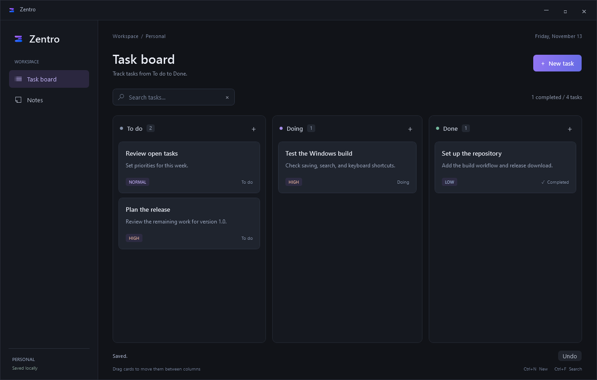

# Zentro

Tasks and notes for Windows.

[Download](https://github.com/Zorak01/Zentro/releases/latest/download/Zentro.exe) · [Releases](https://github.com/Zorak01/Zentro/releases)



Drag tasks between To do, Doing, and Done. Click a card to edit it. Notes have their own view. Search covers titles and text.

`Ctrl+N` new · `Ctrl+F` search · `Ctrl+S` save · `Esc` cancel

Undo restores the last change, including deleted tasks and notes.

## Development

Requires Windows and the .NET 9 SDK.

```powershell
./build.ps1
./build.ps1 -Publish
```

The first command runs the checks and builds the app. The second also produces `artifacts/Zentro/Zentro.exe` with the runtime included.

App code is in `src/Zentro`. Workspace checks are in `tests/Zentro.Checks`.

## Data

Saved locally to `%LOCALAPPDATA%/Zentro/workspace.json`. The previous save is kept as `workspace.json.bak`.

Existing organiZe data is imported on first launch. The original file is kept.
